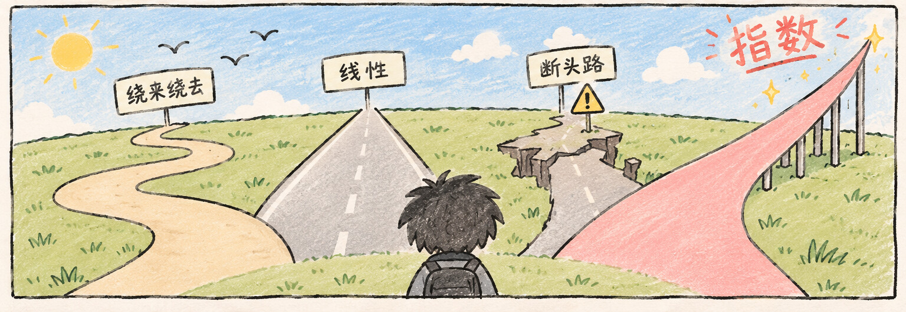
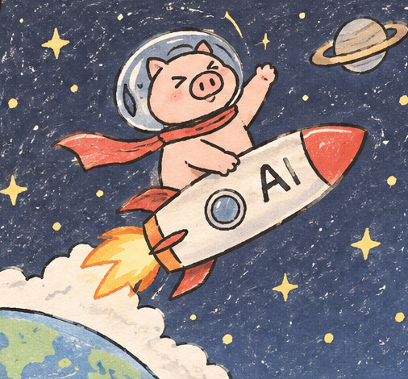

九十年代出的考题，机器要二十年才考到人的水平。而现在的榜单，被刷新的速度以月来衡量。
一年前，大家说模型要到 2026 年、2027 年才能干完一整天的活。而现在，相同时间，模型恐怕可以干完一个月的活。
十年前，最大的模型用的训练算力，是今天的千万分之一。
人们管这叫 scaling law

我见过一个人。他说三年内会有 AGI。几分钟后，他讲起自己的十年规划：博士，博后，教职。
他嘴上是曲线，手里拿着的却是直尺，誓要把前人走过的路，往后延长。
另一个人，花两年做一个项目。做完那天，别人拿新模型随手一试，效果更好。
我给他听了 MJ 的 You are not alone，他感觉好多了。

七十年的 ai 研究，最后汇成了一句“苦涩的教训”：能吃下更多算力的方法，最后总会赢过人精心设计的方法。

试问，如果明年的模型再强十倍，你今天做的事，是更值钱，还是变得多余？
如果是更值钱，恭喜你，模型每进一步，你也跟着进一步。
如果是变得多余，你做得越久，损失越大。
两种结果，取决于你的选择。

选择稳定可复现的道路是人的天性。
可是，十年后的教职、岗位和晋升阶梯，都不会是今天的样子。
按今天的地图走明天的路，看着不烧心，风险一点没少。
更糟糕的是，可能被时代的曲线彻底抛下。
所以真正应该思考的是，哪条路离曲线更近：数据和算力够不够，身边是不是最强的人，迭代够不够快。
你的选择是否随着时代的发展，AI 的发展而 scale

今年是 2026 年，我们仍站在这根指数曲线的起点。
骑上火箭，猪也可以太空漫步。

